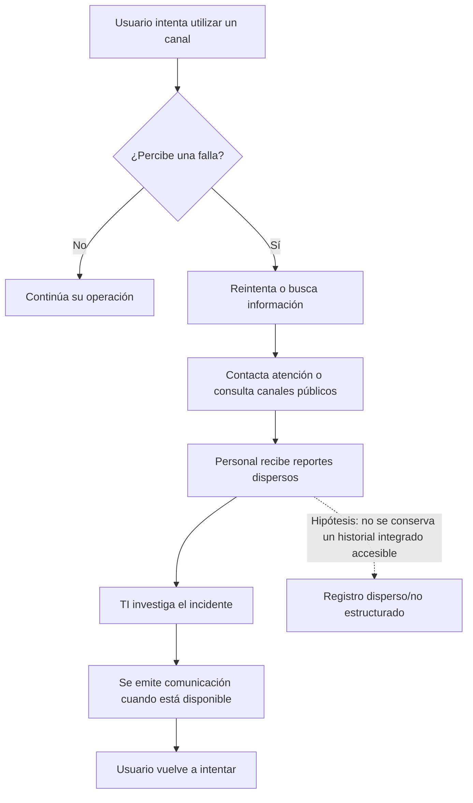
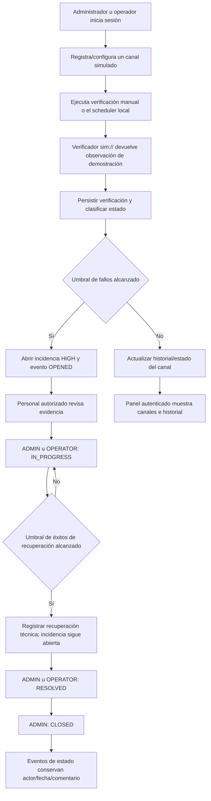
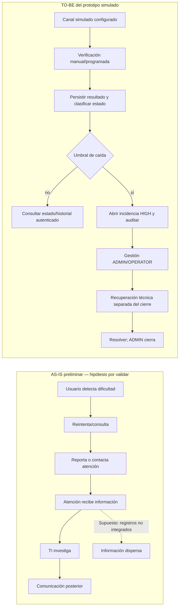
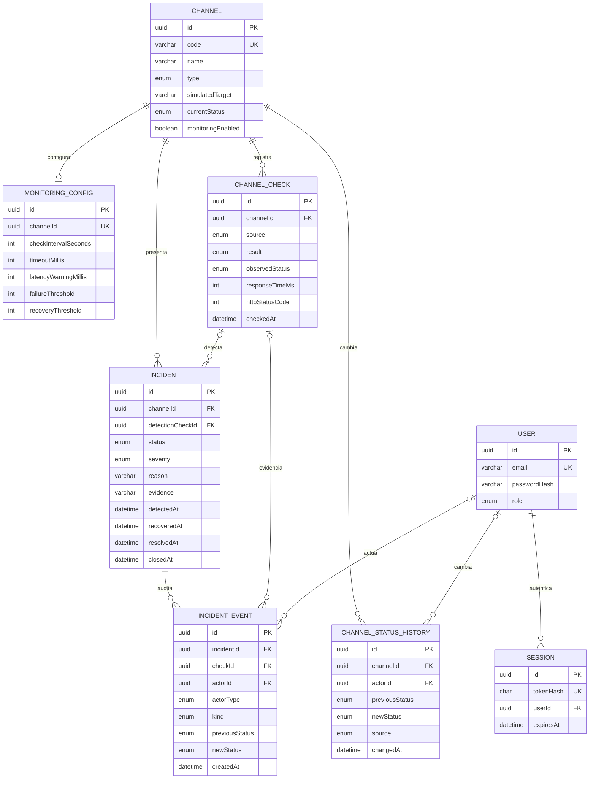

# Informe de Análisis — SIMONA-BN

## 1. Identificación y criterio de evidencia

| Campo | Información |
|---|---|
| Curso | Sistemas de Información (SIS309), semestre 2026-II, Grupo 1 |
| Institución y programa | Universidad Nacional del Altiplano, Escuela Profesional de Ingeniería de Sistemas |
| Docente | Ing. Marga Isabel Ingaluque Arapa (según el plan fuente; confirmar) |
| Alcance temporal | Etapas iniciales y avance solicitado hasta semana 9 |
| Fecha de esta versión | 15 de octubre de 2026 |
| Evidencia de investigación primaria en los archivos revisados | No se localizaron entrevistas, encuestas, observaciones, actas ni resultados de validación |

Este informe separa (a) la hipótesis académica de problema descrita en el plan fuente, (b) las funciones verificables en el repositorio y (c) las actividades por realizar. La existencia de código o pruebas escritas no prueba aprobación docente, uso institucional ni ejecución exitosa de una prueba. La semana 9 es el corte solicitado; no se infiere del historial Git, que no registra commits.

No se ejecutaron suites de pruebas para preparar este documento. El repositorio contiene [`QA-REPORT.md`](../QA-REPORT.md), fechado 14/10/2026, que **reporta** 38 pruebas aprobadas y 8 omitidas, además de lint, chequeo de tipos y compilación aprobados. El mismo informe especifica que las pruebas persistentes/concurrentes M1–M2 no se ejecutaron por falta de `TEST_DATABASE_URL` y acceso utilizable a PostgreSQL, y que la UI autenticada no se validó. Se atribuyen esos resultados al informe existente; no se han repetido ni verificado en esta preparación documental.

## 2. Descripción del problema

El plan de proyecto plantea analizar la detección y comunicación de interrupciones en canales digitales vinculados con la disponibilidad de pagos y pensiones del sector público. La necesidad informacional propuesta es disponer de estado, historial y seguimiento estructurado para que los responsables puedan evaluar una incidencia.

**Estado de validación:** la afirmación de que las interrupciones son recurrentes y que el proceso actual es reactivo proviene de la formulación preliminar del plan de proyecto y de referencias allí citadas. No se verificó de forma independiente en este trabajo ni se encontraron datos primarios anexos. No debe presentarse como diagnóstico observado ni atribuirse al BN como declaración institucional.

## 3. Situación actual (AS-IS) — hipótesis por validar

El siguiente diagrama modela la hipótesis preliminar del plan; no es un proceso oficial del BN ni resultado de observación directa.



### Registro de afirmaciones y pendientes AS-IS

| Afirmación inicial | Clasificación | Evidencia disponible / pendiente |
|---|---|---|
| Los canales pueden presentar interrupciones que afectan a usuarios | Contexto del proyecto, no incidente investigado aquí | El plan cita publicaciones/notas; revisar fuentes originales y fechas antes de usarlo como hecho |
| Los reportes pueden provenir de canales distintos | Hipótesis del plan | Pendiente de entrevista/observación autorizada |
| La atención puede responder de forma reactiva | Hipótesis del plan | Pendiente de contrastar con personal o documentación |
| No existe un registro centralizado público | Afirmación negativa no demostrada | Pendiente de búsqueda documental sistemática; no puede afirmarse solo por no encontrarlo |
| No hay métricas públicas de disponibilidad | Afirmación negativa no demostrada | Pendiente de verificar publicaciones oficiales y definir periodo/fuentes |

**Actividades de campo pendientes:** entrevistas a usuarios y, si fuera posible y autorizado, personal; encuestas; observación de procesos; análisis documental con referencias completas; registro de fecha, alcance, consentimiento y hallazgos. No se reportan tamaños de muestra ni resultados.

## 4. Situación futura propuesta (TO-BE)

El TO-BE se refiere al comportamiento del **prototipo académico con servicios simulados**, no a una propuesta aprobada para instalarse en infraestructura del BN.



El repositorio implementa catálogo autenticado, verificación simulada, persistencia, transición de estados y auditoría. **No** implementa el portal público, reportes ciudadanos, suscripciones, notificaciones al público, importación de calendario de pagos ni indicadores agregados propuestos en el plan original.

## 5. Actores y necesidades

| Actor / rol | Necesidad analítica | Correspondencia técnica y limitación |
|---|---|---|
| ADMIN de demostración | Administrar catálogo y ciclo de incidentes, incluido cierre | Cuenta de desarrollo provisionable por seed; tiene acciones de gestión |
| OPERATOR | Registrar/configurar canales, ejecutar verificaciones y gestionar incidentes hasta resolución | Implementado; no puede cerrar incidencia |
| VIEWER | Consultar canales e incidencias | Registro abierto asigna `VIEWER`; no puede modificar |
| Operador/administrador de TI (actor institucional propuesto) | Ver señales reproducibles, evidencia y estado | Mapeo académico; no se ha validado con personal real |
| Usuario final (trabajador/pensionista) | Consultar estado y recibir avisos | Necesidad propuesta; el prototipo actual no incluye portal o notificaciones públicas |
| Atención al Cliente, jefatura TI, Unidades Ejecutoras | Acceder a información específica de atención/gestión | Necesidades propuestas; no existen vistas o permisos diferenciados para estos perfiles |
| Equipo de desarrollo y docente | Revisar requisitos, implementación y demostración | Entrega académica; rúbrica y aceptación docente pendientes de adjuntar |

## 6. Requisitos

### 6.1 Requisitos funcionales

Los requisitos “implementados” se refieren a código encontrado, no a aceptación por usuario.

| ID | Requisito | Prioridad | Estado en el repositorio / criterio verificable |
|---|---|---:|---|
| RF-01 | Registrar usuario con correo y contraseña; nueva cuenta recibe rol `VIEWER` | Alta | Implementado en `/api/auth/register`; validación de contraseña mínima de 12 caracteres |
| RF-02 | Iniciar, consultar y cerrar sesión | Alta | Implementado mediante cookie de sesión y endpoints `/login`, `/me`, `/logout` |
| RF-03 | Consultar listado/detalle de canales y su última verificación | Alta | Implementado; acceso autenticado |
| RF-04 | Registrar y actualizar canal de demostración | Alta | Implementado; solo `ADMIN`/`OPERATOR`; destino simulado o URL HTTPS autorizada |
| RF-05 | Habilitar/deshabilitar monitoreo, fijar mantenimiento y editar parámetros | Alta | Implementado; configuración validada por rango |
| RF-06 | Ejecutar verificación manual con resultado persistido e historial paginado | Alta | Implementado; `POST /:id/check` y `GET /:id/checks` |
| RF-07 | Ejecutar verificaciones programadas respetando intervalo y excluyendo mantenimiento | Alta | Implementado por scheduler de proceso; no coordinado entre instancias |
| RF-08 | Clasificar estado según latencia, fallos y recuperación consecutivos | Alta | Implementado con valores configurables |
| RF-09 | Abrir incidente automática y auditablemente al llegar al umbral de caída, con evidencia | Alta | Implementado; severidad automática `HIGH` y evento del sistema |
| RF-10 | Evitar múltiples incidencias activas para el mismo canal/episodio | Alta | Implementado mediante transacción, índice único parcial y lógica de deduplicación |
| RF-11 | Registrar recuperación técnica sin cerrar automáticamente la incidencia | Alta | Implementado; evento `CHANNEL_RECOVERED`; recuperación y resolución se separan |
| RF-12 | Consultar/filtrar/listar incidencias, evidencia y eventos | Alta | Implementado para usuarios autenticados |
| RF-13 | Cambiar incidencia por transiciones permitidas y registrar actor/comentario | Alta | Implementado; viewer denegado, cierre reservado a `ADMIN` |
| RF-14 | Consultar canal públicamente sin iniciar sesión | Media | **No implementado** |
| RF-15 | Enviar notificaciones/alertas al usuario o personal | Media | **No implementado** |
| RF-16 | Reportar fallas desde un formulario público y agregarlas | Media | **No implementado** |
| RF-17 | Producir KPI/reportes y cruzar con calendario de pagos | Media | **No implementado** |
| RF-18 | Administrar usuarios y roles desde UI/API | Media | **No implementado**; rol `ADMIN` de desarrollo se prepara con seed |

### 6.2 Requisitos no funcionales y límites medibles

| ID | Requisito/propiedad | Base verificable | Límite conocido |
|---|---|---|---|
| RNF-01 | Persistencia relacional | PostgreSQL + Prisma | Sin objetivo de disponibilidad productiva ni política de backup implementada |
| RNF-02 | Validación de entradas y errores | Zod, límites de tamaño JSON de 16 KiB y middleware central | No equivale a una auditoría de seguridad completa |
| RNF-03 | Protección de credenciales | Hash `scrypt` con sal; token de sesión aleatorio almacenado como hash SHA-256 | No se dispone de prueba de penetración o revisión externa |
| RNF-04 | Cookie de sesión | `HttpOnly`, `SameSite=Strict`, expiración; `Secure` en producción | Requiere despliegue HTTPS correcto en producción |
| RNF-05 | Control de acceso | Roles `ADMIN`, `OPERATOR`, `VIEWER` | Administración de cuentas/roles no está disponible desde el producto |
| RNF-06 | Restricción del verificador HTTP | HTTPS, allowlist explícita de `host[:puerto]`, sin credenciales ni redirecciones | Debe mantenerse desactivado para el escenario académico simulado |
| RNF-07 | Consistencia en concurrencia de incidencias | Transacción con bloqueo de fila e índice único parcial | No sustituye coordinación distribuida del scheduler entre instancias |
| RNF-08 | Compatibilidad local | README recomienda Node.js 20.19+ (22 LTS) y PostgreSQL 16+ | Sin benchmark de volumen, carga o latencia de interfaz |
| RNF-09 | Trazabilidad | Historial de estado, verificaciones y `IncidentEvent` | No se ha definido retención, exportación ni respaldo operativo |
| RNF-10 | Disponibilidad/recuperación del servicio SIMONA-BN | — | No hay SLO/SLA aprobado ni medición en ambiente productivo |

## 7. Reglas de negocio de monitoreo e incidencias

1. La configuración inicial por canal es intervalo **60 s**, timeout **5.000 ms**, alerta de latencia a partir de **1.500 ms**, **3 fallos consecutivos** para caída y **2 éxitos consecutivos** para recuperación. Los valores pueden modificarse respetando límites de validación.
2. El scheduler dispara barridos cada 15 segundos y verifica canales habilitados según el intervalo propio; el intervalo no significa que toda verificación ocurra exactamente en el segundo solicitado.
3. `FAILURE` y `TIMEOUT` cuentan como fallos. Antes de alcanzar el umbral, el estado es `DEGRADED`; al alcanzar el umbral pasa a `UNAVAILABLE`.
4. Una respuesta lenta igual o mayor que el umbral de latencia produce estado `DEGRADED`; una respuesta rápida satisfactoria produce `AVAILABLE`.
5. Para salir de `UNAVAILABLE` se requieren observaciones saludables consecutivas (`SUCCESS` o `DEGRADED`) según `recoveryThreshold`; antes de alcanzar ese número el canal sigue `UNAVAILABLE`.
6. `MAINTENANCE` queda excluido del scheduler y no admite verificación manual; el actor autorizado puede devolverlo a `UNKNOWN`.
7. Al alcanzar caída se crea una incidencia `OPEN`, severidad `HIGH`, razón, evidencia de detección y evento `OPENED` del sistema. Las fallas continuas no duplican la incidencia activa.
8. La recuperación técnica almacena `recoveredAt` y `CHANNEL_RECOVERED`, pero **no** cambia el estado administrativo de la incidencia.
9. Transiciones permitidas: `OPEN → IN_PROGRESS`; `ACKNOWLEDGED → IN_PROGRESS` (compatibilidad); `IN_PROGRESS → RESOLVED`; `RESOLVED → CLOSED`. `ADMIN` u `OPERATOR` pueden gestionar las transiciones salvo cierre, que es exclusivo de `ADMIN`.
10. Los cambios de estado administrativos almacenan actor, estado anterior/nuevo, fecha y comentario opcional. No se borra historial por resolver o cerrar.
11. Tras recuperación técnica, una caída posterior puede originar otro episodio/incidencia; no se abre un episodio nuevo si el incidente más reciente aún no registra recuperación técnica.

## 8. Modelo de procesos

El AS-IS de abajo es una hipótesis documental. El TO-BE corresponde al flujo implementado en el prototipo, salvo portal/notificaciones, que se omiten porque no existen.



### Flujo de excepción (M1/M2)

```mermaid
sequenceDiagram
    participant S as Scheduler/operador
    participant V as Verificador simulado
    participant M as MonitoringService
    participant DB as PostgreSQL
    participant I as Incident lifecycle
    S->>V: verificar(target, timeout)
    V-->>M: source, result, latencia, detalle
    M->>DB: bloquear canal; leer estado e historial
    M->>M: clasificar según umbrales
    M->>DB: persistir check y cambios de estado
    alt Umbral de fallos alcanzado
        M->>I: evaluar incidente
        I->>DB: OPEN + evidencia + OPENED (misma transacción)
    else Salida de UNAVAILABLE
        M->>I: registrar recuperación técnica
        I->>DB: recoveredAt + CHANNEL_RECOVERED
    end
    DB-->>S: resultado persistido
```

## 9. Modelo conceptual y lógico de datos

El esquema implementado se encuentra en [`apps/api/prisma/schema.prisma`](../apps/api/prisma/schema.prisma). Los nombres entre paréntesis son tablas mapeadas.



La relación canal-configuración es opcional en la base de datos (`0..1`), aunque los endpoints de creación y seed crean configuración por defecto. `Incident.detectionCheckId`, `IncidentEvent.checkId`, `IncidentEvent.actorId` e identificadores de actor del historial pueden ser nulos por diseño. Las verificaciones no guardan datos de clientes.

## 10. Matriz de trazabilidad (requisito → implementación → pruebas)

La columna “prueba existente” identifica código de prueba dentro del repositorio. Cuando `QA-REPORT.md` reporta resultados, se citan con su fecha y alcance; no se certifica una nueva ejecución. La evidencia detallada debe leerse en ese informe.

| Req. | Implementación verificable | Prueba(s) localizada(s) | Estado de evidencia |
|---|---|---|---|
| RF-01/02, RNF-03/04 | [`auth/routes.ts`](../apps/api/src/auth/routes.ts), `auth/session.ts`, `auth/password.ts` | `auth/routes.test.ts`, `auth/password.test.ts`, integración `database.integration.test.ts` | QA del 14/10 reporta suite ejecutada; el recorrido DB-gated no está verificado |
| RF-03/04/05 | [`channels/routes.ts`](../apps/api/src/channels/routes.ts), `channels/schemas.ts` | `channels/schemas.test.ts`, `database.integration.test.ts` | QA reporta pruebas no dependientes de PostgreSQL; las pruebas persistentes están omitidas |
| RF-06 | [`monitoring/runtime.ts`](../apps/api/src/monitoring/runtime.ts), `monitoring/service.ts` | `database.integration.test.ts` (persistencia/historial) | Persistencia requiere PostgreSQL; no verificada según QA |
| RF-07 | [`monitoring/scheduler.ts`](../apps/api/src/monitoring/scheduler.ts), `monitoring/service.ts` | `monitoring/scheduler.test.ts` | QA reporta pruebas de scheduler ejecutadas/aprobadas |
| RF-08 | [`monitoring/classification.ts`](../apps/api/src/monitoring/classification.ts) | `monitoring/classification.test.ts` | QA reporta pruebas de clasificación ejecutadas/aprobadas |
| RF-09/10/11 | [`incidents/lifecycle.ts`](../apps/api/src/incidents/lifecycle.ts), `monitoring/service.ts`, migración inicial | `incidents/monitoring-lifecycle.test.ts`, `database.integration.test.ts` | QA reporta unitarias aprobadas; flujo persistente M1→M2 omitido/no verificado |
| RF-12/13 | [`incidents/routes.ts`](../apps/api/src/incidents/routes.ts), `incidents/lifecycle.ts` | `incidents/routes.test.ts`, `incidents/lifecycle.test.ts`, `database.integration.test.ts` | Unitarias reportadas; persistencia y ciclo integrado no verificados |
| RNF-02/05 | [`http/error-handler.ts`](../apps/api/src/http/error-handler.ts), `auth/middleware.ts` | `http/error-handler.test.ts`, `auth/routes.test.ts`, `channels/schemas.test.ts` | Pruebas en QA reportadas; no equivale a revisión externa de seguridad |
| RNF-06 | [`monitoring/verifiers.ts`](../apps/api/src/monitoring/verifiers.ts), `config/env.ts` | `monitoring/verifiers.test.ts`, `config/env.test.ts` | QA reporta pruebas del verificador/configuración ejecutadas/aprobadas |
| RF-14–18 | No se encontró código de portal/notificaciones/reportes/calendario/gestión de roles | Ninguna evidencia funcional en la suite revisada | No implementado |

## 11. Pendientes de análisis y aceptación

- Confirmar con la docente formato, rúbrica, reglas de citación, alcance exigido y fechas del curso.
- Validar la situación actual usando fuentes primarias/secundarias identificables; completar bibliografía del plan inicial y comprobar cada referencia.
- Realizar o declarar formalmente no realizadas las entrevistas, encuestas, observación y pruebas con usuarios.
- Obtener revisión del modelo AS-IS y TO-BE; el BN no ha confirmado ni aprobado los diagramas.
- Acordar requisitos no funcionales cuantitativos solo con una fuente/criterio explícito; no utilizar metas no aceptadas como SLA.
- Ejecutar suites automatizadas en entorno local y adjuntar logs/resultados. Las pruebas de persistencia requieren `TEST_DATABASE_URL` local con base `_test` y migraciones aplicadas.
- Evaluar brechas frente a los módulos futuros del plan: portal público, alertas, notificaciones, reportes/KPI, calendario de pagos y gestión de usuarios.
- Preparar actas/evidencias de revisiones y demostrar únicamente escenarios simulados.
